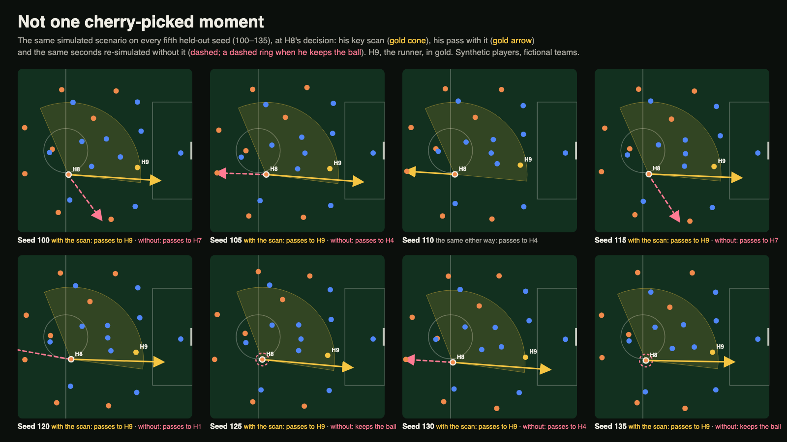

# Through Their Eyes

[](https://github.com/timothyzhbw-jpg/through-their-eyes/actions/workflows/ci.yml?query=branch%3Amain)
[](https://github.com/timothyzhbw-jpg/through-their-eyes/actions/workflows/deploy.yml?query=branch%3Amain)
[](.github/workflows/ci.yml)
[](#synthetic-data-only)
[](LICENSE)

> **See what they saw.** An AI studio that explains key football moments through the player's own
> perception — where he looked before the ball arrived, what he saw, what he believed — and
> re-simulates the moment without the look that made the play, with the same seed and the same
> random draws, so the only difference is what he no longer saw: over 40 held-out seeds,
> <!--num:H1.k-->33<!--/num--> decide differently. Others count scans or force a different action;
> we remove one look and leave the decision to him.

**Every line the crew says is checked by code before it airs.** The model never writes a number: it picks verified claims, and code fills in the values. In an offline stress test of <!--num:V1.total-->2,837<!--/num--> deliberately broken lines, the Verifier kept every one off the air; without it, <!--num:V1.aired-->2,823<!--/num--> would have aired, <!--num:V1.false-->888<!--/num--> of them stating something false ([crew_evidence](eval/reports/crew_evidence.md)).
Around it: the whole match streams live at 1×, with its moments in **⋯ Settings → Moment**, the
match recap, the Tactics lab, five audiences, and English and Chinese.

### [▶ Try the live app](https://ttesite1ff906.z14.web.core.windows.net) · free, no login, a synthetic match with fictional players

**[▶ Watch the video](https://youtu.be/Bl4_afw83Gc)** (1:30, captions burned in)

**Who pays, and what a moment costs.** Broadcasters, for a "through his eyes" studio segment whose
overlays arrive as timecoded cues for their graphics engine; clubs and academies, to review and
train scanning on their own tracking; the league's fan apps, for explainers in their fans'
languages (we ship English and Chinese) and audio description for blind and low-vision fans.
One explained moment in four scripts costs about $0.01 in model calls, and a re-watch costs no
model call (breakdowns are cached), so a licence is priced by the tracking feed, hosting and
editorial review, not by the model. These are hypotheses: no customer has seen it yet
([four products](#one-engine-four-products), [business model](#business-model), [who uses it](#who-uses-it)).

**Category: Best Multi-Agent System.** The crew in 30 seconds ([full answer](#best-multi-agent-system), each judging criterion in [RUBRIC_MAP](docs/RUBRIC_MAP.md)):
- Four model agents on Microsoft Agent Framework (Director; Analyst, calling our MCP tool server; Telestrator; narration in two voices) and two code steps (Verifier, Voice), joined by typed handoffs, a rewrite loop and checkpoints.
- Models choose verified claim IDs; code fills in every number, and the Verifier vetoes any line it refutes.
- Take any agent down on the live site and the breakdown still airs on that agent's template; bring it back and it runs again from the latest Agent Framework checkpoint ([failure drill](https://ttesite1ff906.z14.web.core.windows.net/?tour=producer)).
- Every aired line traces back to its claims, the voice call that chose it, the Verifier round that passed it and its voice cue.

[](https://ttesite1ff906.z14.web.core.windows.net/?view=pov&at=key-scan&intro=0)

<sub>The live app through the eyes of J. Ferriday, the midfielder, as he looks over his shoulder,
away from the ball. The runner N. Varnhall (the gold 9, by the goal on the right) is in his sight
during this look and at no other time before his pass. The caption is a verified claim (✓).</sub>

## Judge it in 3 minutes
1. **See what he saw.** [First person at the key scan](https://ttesite1ff906.z14.web.core.windows.net/?view=pov&at=key-scan&intro=0):
   press **Play**. Playback slows through the look (the KEY SCAN tag), and the runner N. Varnhall
   (No. 9) comes into view.
2. **Take the look away.** [Without the look](https://ttesite1ff906.z14.web.core.windows.net/?run=counterfactual&at=decision&view=tactical):
   the same moment re-simulated with that one scan removed. He no longer knows where Varnhall is,
   and plays it back to K. Annersley (No. 4); **With the scan** switches back to the pass to
   Varnhall. Without the look, <!--num:H1-->33 of 40<!--/num--> held-out seeds decide differently
   ([hero_flip](eval/reports/hero_flip_blind_side_run.md)).
3. **Hear the crew explain it, then try to fool the checker.** [Analyst · 中文](https://ttesite1ff906.z14.web.core.windows.net/?persona=analyst&lang=zh&intro=0):
   the match streams in on the tactical board with pitch control, the analyst's view, and once
   the moment is detected the agent crew's breakdown plays (Microsoft Foundry; **⋯ Settings →
   Sound** for Azure AI Speech). Click a caption to open its claims and
   the evidence frame. Then [try a wrong number](https://ttesite1ff906.z14.web.core.windows.net/?persona=analyst&tamper=cf_value)
   and press **Check**: the verifier refutes it, and the line would not air.

[The full tour](#the-full-tour) adds your own "What if…?", taking an agent down mid-breakdown,
and a whole stitched match.

## From event to value
The site opens on a [landing page](https://ttesite1ff906.z14.web.core.windows.net/?door=home):
the promise and one **Watch the look (60 s)** beside a short muted loop recorded from the live app
at the key scan (it opens the same story), the three doors in a few lines each with every feature
one link away, and the evidence in one line. The brand in the header comes back to it. The three
doors are always in the header beside one **⋯ Settings** menu (the moment, the audience and
language, who to follow, sound, view options and the full tour).
[**The look**](https://ttesite1ff906.z14.web.core.windows.net/?door=look) is the
hero moment's story in about a minute: his scan, the run without it, the two compared from above
(with **Step through his looks** and **With two more scans** one link away) and the Verifier
refusing a wrong number, then an end card whose only choices are the other two doors and
**Watch again**. [**Your turn**](https://ttesite1ff906.z14.web.core.windows.net/?door=turn)
puts you in his boots: **Make his call**, **See through his eyes** and **Train your scanning**.
[**For studios**](https://ttesite1ff906.z14.web.core.windows.net/?door=studios) is what one
moment does for the league's revenue, broadcast and social first, as four solutions:
- **A · [AI Tactical Broadcast](https://ttesite1ff906.z14.web.core.windows.net/?step=broadcast)**:
  a broadcast's questions ("Why did this high press work?") open the Tactics lab card or the scan
  story that answers them, every number with its source.
- **B · [AI Personalised Commentary](https://ttesite1ff906.z14.web.core.windows.net/?step=commentary)**:
  casual, tactical, one player followed, English or Chinese (picked in Settings), and the AI crew
  that writes it, with its evidence and the failure drill.
- **C · [AI Automated Highlights](https://ttesite1ff906.z14.web.core.windows.net/?step=highlights)**:
  the highlight, shot list, captions, posts per platform and 16:9 and 9:16 cards, built offline
  from the verified breakdown for the league's own channels.
- **D · [AI Stadium Experience](https://ttesite1ff906.z14.web.core.windows.net/?step=stadium)**:
  the main board, tunnel LED and ribbon ring for the moment, and the Stadium Screen Studio's
  virtual preview.

Then [Value](https://ttesite1ff906.z14.web.core.windows.net/?step=value): the league's revenue
levers in words (no revenue figure), the measured model cost per verified breakdown, and the demo
KPIs, every simulated figure badged. The old `?step=tactics`, `content` and `crew` links open A, C
and B.

Also in the app, each a few clicks from the moment:
- **Minimal live screen.** The look opens on one live view; the other view is a small picture in
  picture and every overlay is behind **View options**.
- **Tactics lab and glossary.** **For studios → Tactical broadcast** measures five tactics on the
  synthetic match. Every parameter has **Pro** and **Plain** explanations, a collapsed definition
  and a source. Tactical terms in commentary and studio explanations open glossary definitions;
  analysts receive extra detail where available.
- **Scan story.** [His looks, step by step](https://ttesite1ff906.z14.web.core.windows.net/?play=steps):
  every look he took before the ball arrived is frozen and explained (which way, who came into
  view, how his picture changed), then his decision. Its [coach's example](https://ttesite1ff906.z14.web.core.windows.net/?play=steps&match=pro_scan-116)
  walks through `pro_scan`: look left, drop back, look right, receive on the half-turn and play
  forward, with the options each look opens or closes.
- **Scroll reveal.** Chapter cards ease into view and headings lift word by word as the reader
  scrolls. Deep links leave text visible, and reduced motion disables the animation.
- **With two more scans.** In the "Without the scan" panel, the opposite experiment: add one look
  to his left and one to his right and his decision changes in <!--num:H10.k-->0<!--/num--> of
  <!--num:H10.n-->40<!--/num--> held-out seeds. More looks are not the right look
  ([extra_looks](eval/reports/extra_looks_blind_side_run.md)).
- **Your call.** [Decide with what he knew](https://ttesite1ff906.z14.web.core.windows.net/?play=yourcall):
  every option he had is listed and your pick is rated, then the reveal shows what he did and why.

**Demo data.** The audience, engagement and sponsor figures in Automated highlights and Value are
simulated by a seeded model, not measured: nobody has watched this app. Each one carries the badge
"Demo data: simulated audience, not real results". Match facts come from the simulator and are
checked by the Verifier. Clubs, players and sponsors are all fictional.

## What only we do
**A vision cone says what he could have seen. We model where he looked and what he still
believed, and re-run the same seconds with one look removed.**

First-person replays and vision cones already exist ([related work](#related-work)); they show
what a camera, or a cone, could see. We model what the player *knew*. Each simulated player
turns his head on a schedule calibrated to published scan rates (2.77 scans in the 10 s before
receiving, against 3.0 ± 2.1 in Jordet et al. 2020: [realism](eval/reports/realism.md)), sees
only what falls in his field of view, and decides on his *belief*: everyone where he last saw
them, carried forward. Other tools show the passing lanes that existed; we show the ones he knew
existed. And because the match is simulated, a moment can be played again with one look removed:
the run is the same up to that scan and differs only through what he no longer saw
([test](tests/test_export.py#L37)), so what he would have done without it is re-simulated, not
guessed. Under all of it runs the backbone a broadcast needs: a crew of agents writes the
breakdown for each audience and language, and code checks every number the crew says or
captions before it airs (all <!--num:A5.k-->90<!--/num--> falsified claims refuted, and <!--num:A5b.rejected-->0<!--/num--> of <!--num:A5b.n-->468<!--/num--> true claims wrongly
rejected: [corruption](eval/reports/corruption.md)).

## Path to production
- **Who it is for.** A broadcaster's studio analyst explaining a replay on air, a club's
  analysts and coaches reviewing scanning and decisions with players, and the league's fan apps
  ([who uses it](#who-uses-it)).
- **What it needs as input.** Player tracking at 25 Hz with head direction, the kind stadium
  limb tracking or broadcast pose models report. [analytics/keypoints.py](analytics/keypoints.py)
  turns COCO-style head, shoulder and hip keypoints into position and head yaw; on synthetic
  keypoints the scan detector keeps a held-out F1 of <!--num:A2-->0.962<!--/num--> with 20 mm of noise per keypoint axis
  ([keypoint_ingest](eval/reports/keypoint_ingest.md)). The belief and the counterfactual need a
  simulator of the match around the moment; ours is that piece.
- **What it hands a graphics engine.** Per moment, a `TelestrationPlan` (timed camera cuts,
  freezes, first-person segments, scan marks, ghost paths) and voice cues
  ([agents/schemas.py](agents/schemas.py)); per match, the recap's cue sheet as timecoded JSON at
  25 fps (`GET /api/recaps/<key>/cues`, [agents/recap.py](agents/recap.py)).
- **Controls.** Code checks every number the crew says or captions before it airs; every verdict
  goes to an audit log (Cosmos DB, `GET /api/matches/<id>/audit`); model calls are rate-limited
  per client and capped per day, with deterministic templates and a cache behind them. The models
  never write a number, in digits or in words: they pick verified claims and code fills in the
  values ([explain/render.py](explain/render.py), [explain/numbers.py](explain/numbers.py)). There is no editor
  sign-off step yet.
- **Validated, and not.** The perception parameters are calibrated to published values: <!--num:R3.inside-->11<!--/num--> of 16
  checkable statistics fall inside the published range ([realism](eval/reports/realism.md)).
  Everything else, the hero results and every counterfactual included, holds inside our simulator
  only; see [Limitations](#limitations).
- **Business model.** Who would pay and for what, what one explained moment costs us to serve
  (about a cent of model calls), and what is still missing: [Business model](#business-model).

## One engine, four products
The **Belief Engine** is our simulator's perception model (scans → field of view → what he
believed → his decision), the same seconds re-run without one look, and a Verifier that checks
every number in code. Four products run on it in the live demo today, on synthetic matches;
none has a customer yet ([business model](#business-model)).

| Product | For | Live today | Not yet |
|---|---|---|---|
| **Studio Segment** | broadcasters' studio shows and alternate streams | [his look](https://ttesite1ff906.z14.web.core.windows.net/?view=pov&at=key-scan&intro=0), [without it](https://ttesite1ff906.z14.web.core.windows.net/?run=counterfactual&at=decision&view=tactical), a presenter's [What if…?](https://ttesite1ff906.z14.web.core.windows.net/?ask=What+if+he+had+kept+the+ball+and+dribbled+forward%3F) re-simulated, the [full-time recap](https://ttesite1ff906.z14.web.core.windows.net/?match=match-1&play=recap) with its timecoded cue sheet | no graphics engine has rendered the cues; no half-time recap |
| **Fan Explainer** | the league's fan apps | five audiences, each with its own lines, camera and voice, in English or Chinese, [audio description](https://ttesite1ff906.z14.web.core.windows.net/?persona=audio_description&intro=0) included; follow a club or a player; [highlights](https://ttesite1ff906.z14.web.core.windows.net/?step=highlights) as posts and 9:16 cards; [Make his call](https://ttesite1ff906.z14.web.core.windows.net/?play=yourcall) | two languages; one audience at a time |
| **Scan Coach** | club video sessions and academies | the [coach's breakdown](https://ttesite1ff906.z14.web.core.windows.net/?persona=coach&intro=0), [the coach's example](https://ttesite1ff906.z14.web.core.windows.net/?play=steps&match=pro_scan-116) look by look, the [drill](https://ttesite1ff906.z14.web.core.windows.net/?play=drill) at two speeds | the club's own tracking: the [keypoint adapter](analytics/keypoints.py) is built, not wired |
| **Verified Feed** | graphics, standards and app teams | `POST /api/verify`, the audit log (`GET /api/matches/<id>/audit`), cue sheets (`GET /api/recaps/<key>/cues`), the [OpenAPI reference](https://tte-api.whiteground-bd319324.northcentralus.azurecontainerapps.io/docs), our MCP tools | checks our own claims only; no editor sign-off step; the MCP server runs over stdio inside the service, with no public endpoint |

## Who uses it
![A storyboard of four real frames from the live app. 1, Saturday half-time, the studio: the first-person view at the key scan, with the KEY SCAN tag and a checked caption. 2, Saturday, the producer's desk: the failure drill panel, the Telestrator down on its template with a Bring back button while the other agents run. 3, Monday, the academy: the drill in first person, the ball arriving, asking where to look. 4, Any day, a fan's phone: the replay on two phones, the analyst in Chinese and the audio description view.](docs/matchday-storyboard.jpg)

A matchday as we picture it. No broadcaster, club or app uses it yet, and every link below runs on
our synthetic match:

1. **Saturday, half-time, the studio.** The stream has flagged the moment the midfielder's pass opened the game. The analyst calls it up: his looks in the seconds before the ball, the runner appearing on one of them, then the same seconds re-run without that look, where he plays it back instead. A graphics engine could draw it from the moment's timed plan ([agents/schemas.py](agents/schemas.py); at full time the recap adds a timecoded cue sheet, [agents/recap.py](agents/recap.py)), and every number in its captions and narration was checked by code before it aired. Today a replay or a vision cone shows what he could have seen, not where he looked or what he believed. [First person at the key scan](https://ttesite1ff906.z14.web.core.windows.net/?view=pov&at=key-scan&intro=0) · [without the look](https://ttesite1ff906.z14.web.core.windows.net/?run=counterfactual&at=decision&view=tactical) · [What if…?](https://ttesite1ff906.z14.web.core.windows.net/?ask=What+if+he+had+kept+the+ball+and+dribbled+forward%3F) · [full-time recap](https://ttesite1ff906.z14.web.core.windows.net/?match=match-1&play=recap)
2. **Saturday, the producer's desk.** An agent fails mid-breakdown. Its lines air from the template instead of going silent, and **Bring back** resumes from the last checkpoint. A line the Verifier refutes goes back for a rewrite or is dropped, and every verdict on the crew's lines is in the audit log. [Failure drill](https://ttesite1ff906.z14.web.core.windows.net/?tour=producer) · [try a wrong number](https://ttesite1ff906.z14.web.core.windows.net/?persona=analyst&tamper=cf_value) (a viewer's try is checked the same way, but not logged)
3. **Monday, the academy video session.** The coach opens a moment for a U16 midfielder (on the club's own tracking, once it is connected). The player steps through his own looks, then the drill asks where he should have looked before the ball arrived and shows what that look would have caught. [Step through his looks](https://ttesite1ff906.z14.web.core.windows.net/?play=steps) · [coach's breakdown](https://ttesite1ff906.z14.web.core.windows.net/?persona=coach&intro=0) · [academy drill](https://ttesite1ff906.z14.web.core.windows.net/?play=drill)
4. **On a phone, any day.** A fan taps the replay and hears it at their level, as a casual fan, analyst, player fan, coach or with audio description, in English or Chinese. A blind fan hears where he got the ball, which way he looked and whom he saw, in calm, slower speech ([ACCESSIBILITY](docs/ACCESSIBILITY.md)). [Audio description](https://ttesite1ff906.z14.web.core.windows.net/?persona=audio_description&intro=0) · [Analyst · 中文](https://ttesite1ff906.z14.web.core.windows.net/?persona=analyst&lang=zh&intro=0)

What the research does and does not show about scanning is in
[SUBMISSION, Who uses it](docs/SUBMISSION.md#who-uses-it).

### Business model
Hypotheses, not sales: no customer has seen it. The costs are our own measurements at demo scale,
at Azure list prices ([SUBMISSION, Business model](docs/SUBMISSION.md#business-model)).

| | |
|---|---|
| **What is sold** | A per-match or per-season licence to broadcasters' studios and alternate streams for the explainers and their timecoded cues; per-seat review of scanning and decisions for clubs' analysis departments, on their own tracking; explainers in fans' languages for the league's fan apps, which its partnership with Microsoft already plans ([announcement](https://news.microsoft.com/source/2025/07/01/premier-league-and-microsoft-announce-five-year-strategic-partnership-to-personalize-the-fan-experience-with-ai-for-1-8-billion-people/)). We set no price. No betting use. |
| **What it costs to serve** | One explained moment in four scripts (casual and analyst, each in English and Chinese): about $0.01 of model calls, and about $0.03 of speech if every line is voiced. Twenty moments in five audiences and two languages: about $0.50 of model calls and $1.40 of speech. Hosting at demo scale: $17–46 a month, idle to busy. A re-watch costs no model call: breakdowns are cached by content. So a per-match price is set by the tracking feed, hosting and editorial review, not by the model. |
| **How a pilot would run** | Once a rights holder supplies tracking with head orientation (below), one broadcaster's studio show uses the segment on its key moments, with an editor signing off each one. It measures the time from the moment to air, how often the segment is used, how many lines the Verifier stopped (every verdict is in the audit log) and how many the editor still changed. |
| **What is still missing** | Tracking with head orientation from a rights holder, the rights to that data, a simulator calibrated on it, and human editorial review: the Verifier catches invented numbers, not omissions. |

## About
Entry for the Microsoft × Premier League "Inside the Game" Developer Hackathon.
Status: **live on Azure**, redeployed from `main` by GitHub Actions: the sim, analytics, explain
layer (moments, lenses, verified claims), the agent crew and the web replay run end to end; see
[docs/SPEC.md](docs/SPEC.md) §8–9.

**How this relates to FIFA AI Pro.** FIFA AI Pro, the assistant Lenovo built with FIFA for the
2026 World Cup teams, answers analysts' questions about *what happened*, from official match data,
before and after a match. We work on a different question: *what he saw and what he believed*,
while the synthetic match streams live. Every number in the captions and narration is a verified
claim that a viewer can open and challenge with **Try a wrong number**, and every "What if…?" is
re-simulated in the sim. Lenovo's Referee View, an AI-stabilised referee body camera, brings fans
a first-person view of what a camera captured; we show what the player perceived. Sources: [docs/REFERENCES.md](docs/REFERENCES.md#related-products-judges-may-know-fifa-ai-pro-and-referee-view-world-cup-2026).

<a name="for-judges-try-it-in-3-minutes"></a>

## The full tour
A simulated match with fictional players; no login. Each link opens the live site on Azure (the
players take a few seconds to load). URL parameters: [web/README.md](web/README.md#url-parameters).

1. **What he saw.** [First person at the key scan](https://ttesite1ff906.z14.web.core.windows.net/?view=pov&at=key-scan):
   J. Ferriday (No. 8), the midfielder, looks over his shoulder, away from the ball, just before
   he receives it (the KEY SCAN badge). That look is the only time before his pass that the
   runner N. Varnhall (No. 9) is in his sight. Press **Play**: playback slows through the look.
2. **With and without that look.** [Without the look, at his decision](https://ttesite1ff906.z14.web.core.windows.net/?run=counterfactual&at=decision&view=tactical):
   the same moment re-simulated with that one scan removed. His picture of Varnhall is now 12 m
   off, and his pass options point backwards; he plays it back to K. Annersley (No. 4). Click
   **With the scan**: one thick line to Varnhall. Over 40 held-out seeds, <!--num:H1.k-->33<!--/num--> decide differently
   without the look ([hero_flip](eval/reports/hero_flip_blind_side_run.md)).
3. **A live breakdown, in Chinese, for the analyst.** [Analyst · 中文](https://ttesite1ff906.z14.web.core.windows.net/?persona=analyst&lang=zh&intro=0):
   the match streams from the API at 25 Hz onto the tactical board with pitch control, the
   analyst's view; once the moment is detected, the agent crew's breakdown plays (Microsoft
   Foundry, cached after the first request). Click a caption to open its claims and the evidence
   frame; **⋯ Settings → Sound** to hear it in Azure AI Speech. Each audience is its own broadcast:
   switch it under **⋯ Settings → Commentary → Watching as**. The casual fan watches through his
   eyes, the coach gets his eyes with the board beside them, audio description a plain broadcast
   camera, each with its own lines and voice ([persona_distinctness](eval/reports/persona_distinctness.md)).
4. **Your own "What if…?"** [A question, prefilled](https://ttesite1ff906.z14.web.core.windows.net/?ask=What+if+he+had+kept+the+ball+and+dribbled+forward%3F):
   press **Ask**. The API maps the question to one of his options, forces it, re-simulates the
   moment and answers with verified lines; the forced run plays as a gold ghost. It is a
   re-simulation, not an estimate: the same simulation, the same keyed random draws and the same
   model of what each player can see; nothing is sampled from other plays or scored by geometry.
   Free questions are rate-limited per client.
5. **The verifier blocking a number.** [Try a wrong number](https://ttesite1ff906.z14.web.core.windows.net/?persona=analyst&tamper=cf_value):
   the evidence card opens on "That look was worth … in expected threat." with a wrong value
   filled in. Press **Check**: the API runs the real verifier on that claim with your number,
   against the match data, and answers "Refuted — this line would not air" with its reason;
   **Check the true value** is supported. Any claim with a number can be tried this way; nothing
   you try is written to the audit log. Live breakdowns never hand it a wrong number, because the
   narration agents pick verified claim ids and never write a digit. Where a model writes free
   text, it blocks: about half of the free-text first drafts (34 of 66 lines) named a player or a
   number no claim holds, for example "H8's picture of A5 was off by 1.2 metres" where the claim
   holds H9 and 0.5, and none of them passed the Verifier
   ([narration ablation](eval/reports/narration_ablation.md#free-text-failures-verbatim)). It also
   refuted <!--num:A5-->90 of 90<!--/num--> perturbed claims, and wrongly rejected <!--num:A5b.rejected-->0<!--/num--> of <!--num:A5b.n-->468<!--/num--> true ones: a number off by one unit or by 20%, a swapped player, a
   wrong order ([corruption](eval/reports/corruption.md)). Every
   verdict behind what the service airs is in the [audit log](https://tte-api.whiteground-bd319324.northcentralus.azurecontainerapps.io/api/matches/blind_side_run-3/audit?limit=5).
6. **Take an agent down, bring it back.** [The failure drill](https://ttesite1ff906.z14.web.core.windows.net/?persona=analyst&lang=en&step=commentary)
   (For studios → B · Commentary, **Behind the commentary: the AI crew**): press **Take down** on
   the Telestrator and run the crew. It fails as in an outage: the call and one retry raise, it
   airs its template plan, and the breakdown still plays. **Bring back** resumes the Agent
   Framework workflow from its checkpoint and re-runs the Telestrator and the step after it; its
   plan replaces the template. The trace id is the run's operation_Id in Application Insights.
   **Crew trace** opens the run as a timeline: each agent's lane, its typed input and output,
   the shared state it read and wrote, the Analyst's MCP tool calls, the Verifier sending a line
   back, and the drill's down → fallback → checkpoint → bring-back.
   Each run counts against the rate limit; a drill lasts until the API's next restart or deploy.
7. **A whole match, four hero moments, a camera director.** [The stitched match on the broadcast camera](https://ttesite1ff906.z14.web.core.windows.net/?match=match-1&camera=broadcast&at=751):
   19 possessions on one clock of about 13½ minutes, opened where the scan hero's possession
   starts. Press **Play**. The camera director suggests a camera with a dot on it in the camera
   switch and says why; one tap takes it, and **Auto director** (beside the switch, or in **⋯ Settings
   → View options**) cuts by itself. Under **⋯ Settings → Moment**, the
   pressure hero has a **Breakdown** too: a centre-back under a high press, and the counterfactual
   forces him to keep the ball (**If he carried it**). He loses it in <!--num:H4-->40 of 40<!--/num--> fresh seeds
   ([pressure](eval/reports/hero_lens_press_escape.md)). The shot hero and corner also open their
   breakdowns there. **⋯ Settings → View options → Skeleton** on the broadcast camera or the board
   draws each player's torso and head direction, the way limb-tracking data is shown.

8. **The match recap, at full time.** [Match recap](https://ttesite1ff906.z14.web.core.windows.net/?match=match-1&play=recap):
   the crew recaps the whole stitched match, as it does when the live stream reaches full time.
   The Director picks the key moments by counterfactual impact, the Analyst reads the match
   stats through our MCP tools, the Telestrator cuts the reel, and every sentence and number on
   the card is verified. **Play the recap reel** plays the moments in order with the camera
   director, and **Overlay cues (JSON)** is the timed, machine-readable cue sheet a broadcast
   graphics engine would render.

Then the [evidence](#evidence) and [Microsoft technology](#microsoft-technologies-where-they-are-used)
tables below; [docs/RUBRIC_MAP.md](docs/RUBRIC_MAP.md) maps each judging criterion to files,
tests, reports and pull requests, and marks what is missing. The fourth hero of the stitched
match is a short corner (possession 14): a defender marks the striker where he believes him to
be, and its **Breakdown** is under **⋯ Settings → Moment** too.

## Try it
- **Web app:** https://ttesite1ff906.z14.web.core.windows.net — opens on the landing page, with The look,
  Your turn and For studios one click away: the hero moment in first person and on the tactical
  board, with and without the look, pass options, blind-side alerts, "What if…?".
- **API:** https://tte-api.whiteground-bd319324.northcentralus.azurecontainerapps.io/health
  - live replay: `wss://…/ws/matches/blind_side_run-3/live` (25 Hz frames, events, moments);
  - a verified breakdown (cached after the first request):
    ```bash
    curl -X POST https://tte-api.whiteground-bd319324.northcentralus.azurecontainerapps.io/api/breakdowns \
      -H 'content-type: application/json' \
      -d '{"match": "blind_side_run-3", "personas": ["analyst"], "languages": ["en"]}'
    ```
  - the end-of-match recap of the stitched match, and its overlay cue sheet
    (`GET /api/recaps/<key>/cues?persona=analyst&language=en`, with the `key` it answers):
    ```bash
    curl -X POST https://tte-api.whiteground-bd319324.northcentralus.azurecontainerapps.io/api/recaps \
      -H 'content-type: application/json' \
      -d '{"match": "match-1", "personas": ["analyst"], "languages": ["en"]}'
    ```
  - a wrong number, checked by the verifier (not audited; no model call):
    ```bash
    curl -X POST https://tte-api.whiteground-bd319324.northcentralus.azurecontainerapps.io/api/verify \
      -H 'content-type: application/json' \
      -d '{"match": "blind_side_run-3", "claim": "cf_value", "slot": "dxt", "value": 0.2}'
    ```
  No login. Model-backed regenerations are rate-limited per client and capped per day; past that
  the service serves the cache or the deterministic template.
- **Failure drill** (tour step 6) over the API; each call counts against the rate limit:
  ```bash
  curl -X POST https://tte-api.whiteground-bd319324.northcentralus.azurecontainerapps.io/api/breakdowns \
    -H 'content-type: application/json' \
    -d '{"match": "blind_side_run-3", "personas": ["analyst"], "languages": ["en"], "fail": ["telestrator"]}'
  curl -X POST https://tte-api.whiteground-bd319324.northcentralus.azurecontainerapps.io/api/breakdowns/<key>/bring-back \
    -H 'content-type: application/json' -d '{"step": "telestrator"}'
  ```

## Evidence
Nothing has been run on real tracking data. Each row says which kind of result it is:
- **Inside the sim**: a fact about the simulated football (his looks, his beliefs, his decisions).
  It holds in our simulator only and would have to be measured again on real tracking.
- **Product**: a fact about our software itself (the checker, the crew, the model calls, the
  deployed service). Its inputs are synthetic, but what it measures is the software a customer
  would run.

[](eval/reports/hero_flip_blind_side_run.md)

<sub>Not one cherry-picked moment: the same scenario on every fifth held-out seed, with H8's key scan and without it, drawn by [eval/seed_gallery.py](eval/seed_gallery.py). Over all held-out seeds, <!--num:H1-->33 of 40<!--/num--> decide differently ([hero_flip](eval/reports/hero_flip_blind_side_run.md)).</sub>

| Claim | Kind | Number | Report |
|---|---|---|---|
| Without one look, the hero decides differently | Inside the sim | <!--num:H1-->33/40<!--/num--> seeds | [hero_flip](eval/reports/hero_flip_blind_side_run.md) |
| Lens selection picks the lens each hero scenario is built for (held-out seeds): scan hero (100–139); pressure hero (fresh 200–239) | Inside the sim | <!--num:H2-->34/40<!--/num-->; <!--num:H3-->40/40<!--/num--> | [scan](eval/reports/hero_lens_blind_side_run.md), [pressure](eval/reports/hero_lens_press_escape.md) |
| Forcing the pressure hero to keep the ball loses it; the possession outcome changes (target ≥ 60%), fresh seeds 200–239 | Inside the sim | <!--num:H4-->40/40<!--/num--> lost; <!--num:H5-->32/40<!--/num--> changed | [pressure](eval/reports/hero_lens_press_escape.md) |
| … the same on seeds 100–139, before → after the decision model saw a presser's run-in (these seeds were used to find the cause) | Inside the sim | 22/40 → <!--num:H6-->30/40<!--/num--> changed | [seeds 100–139](eval/reports/hero_lens_press_escape_100-139.md) |
| Set-piece hero (a corner): without the marker's look the runner is unmarked at the cutback, with it the marker is within 5 m (held-out seeds 100–139), against a gate revised during design (the plan's checks, in the same report, are not met) | Inside the sim | <!--num:H7-->37/40<!--/num--> | [hero_marking](eval/reports/hero_marking_corner_blind_side.md) |
| Scans detected from head yaw alone, nuisance head motion on (held-out F1) | Inside the sim | <!--num:A1-->0.991<!--/num--> | [scan_detector](eval/reports/scan_detector.md) |
| Blind-side alerts vs the sim's beliefs (fresh seeds; an upper bound for real tracking) | Inside the sim | precision ≥ 0.8, recall ≥ 0.7 met | [blind_side](eval/reports/blind_side.md) |
| Perturbed claims refuted by the verifier (a number off by one unit or by 20%, a swapped player, a wrong order; of 100, the 6 that stayed true and the 4 the recording cannot decide are excluded); true claims it wrongly rejected | Product | <!--num:A5-->90/90<!--/num-->; <!--num:A5b.rejected-->0<!--/num--> of <!--num:A5b.n-->468<!--/num--> | [corruption](eval/reports/corruption.md) |
| Sim statistics vs published values | Inside the sim, against published values | table with citations | [realism](eval/reports/realism.md) |
| Free-text vs anchored narration, same moment and seeds: first-draft lines naming a player or number that no claim holds (none passed the verifier); groundedness of the scripts that aired (1–5, Foundry evaluator) | Product | 34 of 66 vs 0 of 111; 4.90 vs 5.00 | [narration_ablation](eval/reports/narration_ablation.md) |
| The crew against one agent doing its four model roles in one call, same moments, tools and schemas (single vs crew): wrong facts aired; model roles kept with the Analyst or the Telestrator down; agent runs over the deployed 8 s step timeout; cost per breakdown | Product | 0 vs 0; 0 of 4 vs 3 of 4; 6 of 6 vs 0 of 66; $0.0046 vs $0.0090 | [crew_vs_single](eval/reports/crew_vs_single.md) |
| One uncached model breakdown on the deployed API (one audience, one language, the Analyst on MCP): on a warm replica; the first request after a deploy; from the cache | Product | 12.9 s; 23.8–25.9 s; 0.15 s | [SPEC §8](docs/SPEC.md#8-platform-and-deploy), [live trace](docs/RUBRIC_MAP.md#the-live-trace) |
| Audio description for blind and low-vision viewers: where he got the ball, which way he looked, whom he saw, each a verified claim; calm, slower SSML at any tier; in the web app sound on, large-print captions, narration and playback controls named and focusable | Product | 6/6 template lines verified, 0 dropped (seed 3, en + zh) | [test_agents](tests/test_agents.py), [access.test](web/src/ui/access.test.tsx) |

## Engineering
| Practice | What it is | Where |
|---|---|---|
| Deterministic sim | The same seed gives byte-identical output. Randomness is keyed per `(match_seed, entity, purpose)`, so a counterfactual differs from the factual run only through its intervention | [sim/rng.py](sim/rng.py), [tests/test_sim_m1.py](tests/test_sim_m1.py) |
| One canonical platform | Committed artifacts (exports, reports, the xT grid) are generated on linux/amd64 in `python:3.11-slim`, with numpy's X86_V4 tier off: where CI and the live API run. macOS and Linux differ in the last bits of libm | [scripts/regen_linux.sh](scripts/regen_linux.sh), [tests/canonical.py](tests/canonical.py) |
| CI gates | ruff and pytest; web typecheck, prettier and vitest, which includes the GPU shader parity test in headless Chrome; the end-to-end smoke test of every page with axe-core's WCAG 2.2 rules. Deploy runs only after the full CI is green on `main` | [ci.yml](.github/workflows/ci.yml), [deploy.yml](.github/workflows/deploy.yml) |
| Infrastructure as scripts | The Azure resources come from two scripts, each refusing a non-personal subscription; the web upload reads every file back before `index.html` switches | [infra/m0_provision.sh](infra/m0_provision.sh), [infra/deploy.sh](infra/deploy.sh) |
| OIDC deploy | GitHub Actions signs in to Azure with a federated identity: no Azure secret is stored | [deploy.yml](.github/workflows/deploy.yml) |
| Traces | OpenTelemetry spans per agent step in Application Insights, each with its source (model or template) and timing | [agents/telemetry.py](agents/telemetry.py), [live trace](docs/RUBRIC_MAP.md#the-live-trace) |
| The demo survives quota loss | A per-client rate limit, a daily model cap and a content-hash cache, with deterministic templates behind them: past a limit the API serves the cached result or the template, flagged | [OPERATIONS](docs/OPERATIONS.md#when-a-quota-runs-out) |
| Laws-of-the-Game audit | Offside, the ball over a line, restarts and keeper handling are checked in every run: <!--num:A6-->0<!--/num--> unpunished breaches | [laws](eval/reports/laws.md) |
| Held-out seeds | Every hero gate is tuned on design seeds and reported on others: the scan hero <!--num:H1-->33/40<!--/num-->, the pressure hero's lens <!--num:H3-->40/40<!--/num-->, the corner hero <!--num:H7-->37/40<!--/num--> | [Evidence](#evidence) |

## Limitations
- **Synthetic data only.** Nothing has been run on real tracking data, which the hackathon rules
  do not allow anyway. The detectors' scores are scores on our simulator.
- **Every counterfactual outcome depends on the simulator.** "Without the look he plays it back"
  is a re-simulation with our models of movement, perception and decisions; on real data it
  could only be an association.
- **Pressure and scanning.** In the published data players scan less when an opponent is tight
  on them (d = +0.57 between 10+ m and 0–1 m). Our simulator has the same sign but a much
  smaller effect (d = <!--num:R4.d-->0.15<!--/num-->, 90% interval over seeds <!--num:R4.lo-->−0.06<!--/num--> to <!--num:R4.hi-->0.36<!--/num-->): one of the <!--num:R3.outside-->5<!--/num--> statistics
  outside the published range; the other four compare scan rates between roles
  ([realism](eval/reports/realism.md)).
- **No tackles yet.** In the stitched matches possession changes hands by interceptions only:
  0 tackles and 0 balls out of play that change possession per 90 minutes over 20 stitched
  matches ([match_stats](eval/reports/match_stats.md)); tackles are switched on in the pressure
  hero's scenario alone.
- **Team shapes are looser than a Premier League side's.** The hero moments are built to stage
  one perception problem, and their defending side is not always a compact back line: in the
  scan hero the back line is spread when the runner gets in behind it. The open-play team shape
  is fitted to published positional data (SPEC 3.2), but a scripted scenario overrides it where
  the moment needs a gap.
- **xT is our own grid**, fitted on synthetic open play, so a gain like "that look was worth … in
  expected threat" is a value inside the simulation.

## Related work
- **First-person replay is not new.** ReSpo.Vision builds 3D tracking from single-camera
  broadcast video, and its digital twin replays real moments from a player's first-person
  perspective, for example through a striker's eyes
  ([tech.eu, 2025-06-10](https://tech.eu/2025/06/10/respovision-raises-eur42m-to-redefine-the-sports-viewing-experience/);
  [respo.vision](https://respo.vision/)).
- **Vision from head orientation is not new either.** Bekkers (2026), *Wide Open Gazes*
  ([arXiv:2602.18519](https://arxiv.org/abs/2602.18519)), turns head and shoulder angles into
  probabilistic field-of-view and occlusion maps, on 32 games of ReSpo.Vision broadcast tracking
  from the 2024 Copa América (§2.2). Our field-of-view model follows it.
- **What we add** is the step after vision: what the player *believed* (each player where he was
  last seen, extrapolated), decisions taken on that belief, and the counterfactual: the moment
  re-simulated with one scan removed, so the replay can show what he would have done without
  that look. POV is how we show it, not the contribution. All of it runs on synthetic data; we
  have not tested it on real tracking.
- Other entries and papers we read: [docs/REFERENCES.md](docs/REFERENCES.md).

## Synthetic data only
Every match, club and player in this project is fictional and generated by our own simulator
(`sim/`). No real match data, footage, logos or player names are used in the app or the repo — not
even for calibration; model parameters come from published research
([docs/REFERENCES.md](docs/REFERENCES.md)).

## Synthetic dataset
The simulator's output is packaged as a small open dataset: 10 stitched matches with events
(passes, receptions, interceptions, possession changes, pressure spells, shots, goals, scans,
restarts), 25 Hz tracking with body and head yaw, match metadata, and at every reception the
receiver's scans and his belief about everyone else against the truth. Datasheet with schema,
units, sources and limitations: [docs/DATASET.md](docs/DATASET.md). One possession is committed
as a sample in [`data/sample/`](data/sample/); [`examples/dataset_quickstart.py`](examples/dataset_quickstart.py)
reads the files.

```bash
uv run python -m sim.dataset --matches 10 --out out/dataset/
uv run python examples/dataset_quickstart.py --data out/dataset
```

## The challenge's pipeline
The brief asks for Ingest → Interpret → Explain → Render → Personalize. The whole match streams
live at 1×. The [diagram](docs/architecture.svg) shows how the stages meet the Azure services.

| Stage | Module | One concrete thing it does |
|---|---|---|
| Ingest | `sim/`, `api/` | the simulator makes every fictional player's tracking, with head and body yaw; the API replays them over a WebSocket at 1× |
| Interpret | `analytics/` | a scan detector reads head yaw alone and finds each look; blind-side alerts flag a runner he has not seen |
| Explain | `explain/` | re-simulates a moment with one look removed and turns the result into claims a deterministic Verifier checks |
| Render | `web/` | first-person replay through his eyes, and a GPU pitch-control overlay on the tactical board |
| Personalize | `agents/` | a crew writes the breakdown for each audience in English or Chinese; Azure AI Speech voices it |

## Layout
Each package's README covers what it does, its modules and data flow, the invariants it keeps
and how to run its tests.

| Path | What | Docs |
|---|---|---|
| `sim/` | synthetic match engine: movement, ball, perception, decisions, scenarios | [sim/README.md](sim/README.md) |
| `analytics/` | kernels: time-to-intercept, pitch control, pressing, vision, xT, scan detector, blind-side alerts | [analytics/README.md](analytics/README.md) |
| `explain/` | moments, lenses, counterfactuals, claims + verifier | [explain/README.md](explain/README.md) |
| `agents/` | Agent Framework workflow on Microsoft Foundry, MCP server | [agents/README.md](agents/README.md) |
| `api/` | FastAPI service | [api/README.md](api/README.md) |
| `web/` | React + three.js front end (React Three Fiber) | [web/README.md](web/README.md) |
| `eval/` | eval suites and reports | [eval/README.md](eval/README.md), [docs/EVALS.md](docs/EVALS.md) |
| `infra/` | Azure setup and deployment | [infra/README.md](infra/README.md) |
| `video/` | capture kit for the demo video | [video/README.md](video/README.md) |
| `tests/` | the Python test suite | [docs/CONTRIBUTING.md](docs/CONTRIBUTING.md#the-checks-ci-runs) |
| `docs/` | specification, references, evals, rubric map, contributing | [docs/SPEC.md](docs/SPEC.md) |
| `data/sample/`, `examples/` | one possession of the synthetic dataset; a quickstart that reads it | [docs/DATASET.md](docs/DATASET.md) |
| `demo/` | hero demo page, rigged-player converter | — |

## Development
Requires [uv](https://docs.astral.sh/uv/) (Python 3.11 is installed by uv). Setup with uv and
npm, the checks CI runs, the pull-request flow and the eval-before-merge rule for `sim/`,
`analytics/` and `explain/` are in [docs/CONTRIBUTING.md](docs/CONTRIBUTING.md).

```bash
uv sync
uv run pytest
uv run ruff check .
```

### API service
```bash
uv run uvicorn api.main:app --reload
```
Live replay over WebSocket at `/ws/matches/blind_side_run-3/live`, moments, cached breakdowns and
"What if…?" answers. `match-1` is a stitched match (`sim/match.py`, SPEC 3.1): 19 possessions,
about 13½ minutes on one clock — 15 open-play passages and four heroes: the scan hero at 0:30, the
pressure hero (`press_escape`) at 5:07, the shot hero (`far_post_finish`) scoring at 7:58 and the
short corner (`corner_blind_side`) at 9:47, at 1–0 — with
moments detected in every possession; breakdowns and what-ifs take the hero moment's id. `match-2`
plays three of those heroes (pressure, corner, scan) on other seeds, in another order (17
possessions, about 12½ minutes; no shot, so 0–0). Without Microsoft Foundry configured, every agent step runs on its
deterministic template.

The container image for Azure Container Apps (main dependencies only, runs as a non-root user):
```bash
docker build -t tte-api .
docker run --rm -p 8000:8000 tte-api   # GET http://localhost:8000/health
```

### Azure smoke test (M0)
Needs the Azure CLI (`az login`) and an Azure for Students (or personal pay-as-you-go)
subscription; the script refuses Microsoft-internal and Enterprise Agreement subscriptions.

```bash
AZURE_SUBSCRIPTION_ID=<subscription id> infra/m0_provision.sh
uv run --env-file .env python -m infra.smoke
```

`m0_provision.sh` creates a resource group with a Microsoft Foundry account, project and one model
deployment, plus an Azure AI Speech resource, then writes the settings to `.env` (git-ignored).
Every variable is documented in [.env.example](.env.example).

## Best Multi-Agent System

<picture>
  <source media="(prefers-color-scheme: dark)" srcset="docs/crew_workflow-dark.svg">
  
</picture>

Agent Framework's own `WorkflowViz` draws this graph from the workflow the API runs
(`build_workflow`); the MCP tool server, the Verifier's rewrite loop and the failure drill's
bring-back are added from the code ([docs/crew_workflow.py](docs/crew_workflow.py), checked by
[tests/test_crew_workflow_diagram.py](tests/test_crew_workflow_diagram.py)). The category asks
for four things; each has a measured number ([docs/NUMBERS.md](docs/NUMBERS.md), rows MA).

### "Distinct roles"

The crew has model agents (Director, Analyst, Telestrator, and narration with its two voices) and code steps
(Verifier, Voice), each with its own schema, timeout and template. The Verifier is a separate gate
that can veto. Of <!--num:MA8.total-->2,837<!--/num--> deliberately broken lines, the Verifier kept every one off the air; without it, <!--num:MA8.aired-->2,823<!--/num--> would have aired, <!--num:MA8.false-->888<!--/num--> of them stating something false ([crew_evidence](eval/reports/crew_evidence.md), MA8).

### "Coordinate through shared state and effective handoffs"

Typed messages on the workflow's edges, and one verified body of evidence every step reads. The
crew trace records each handoff: 394 of 394 aired lines trace to their verified claims, the voice
call that chose them, the Verifier round that passed them and their voice cue
([crew_evidence](eval/reports/crew_evidence.md), MA10).

### "Recover from failures"

With any one agent taken down, every script still aired and most roles still came from the
model; one agent doing all the roles kept none. Bringing the agent back from the Agent
Framework checkpoint restored the fault-free breakdown in every drill ([crew_evidence](eval/reports/crew_evidence.md),
MA1, MA7). Try it on the live site: [the failure drill](https://ttesite1ff906.z14.web.core.windows.net/?tour=producer).

### "An end-to-end outcome a single agent could not achieve as effectively"

What the crew buys is a breakdown that finishes inside the step budget, survives a fault and
recovers cheaply. Under the deployed step timeout, no crew agent run would have timed
out, while every run of one agent doing all the roles in one call would have (MA3). Bringing the
Telestrator back costs the crew less than the single agent's re-run (MA2); the Analyst costs more,
because every step after it runs again (MA2b). What it does not buy is better lines: both
structures aired no wrong facts and scored the same on groundedness
([crew_vs_single](eval/reports/crew_vs_single.md), MA5).


## Architecture
<picture>
  <source media="(prefers-color-scheme: dark)" srcset="docs/architecture-dark.svg">
  
</picture>

Model steps run on Microsoft Foundry and fall back to a deterministic template; the Verifier is
code. The Analyst calls our MCP tool server: in the deployed API as a subprocess for every
uncached model breakdown (`TTE_ANALYST_MCP`, on by default), and from the command line with
`agents.run --mcp`. The
diagram is generated by [docs/architecture.py](docs/architecture.py), and
[tests/test_architecture.py](tests/test_architecture.py) fails when it drifts from the code.

## Microsoft technologies, where they are used
| Technology | Where | Evidence |
|---|---|---|
| Microsoft Foundry (gpt-4.1-mini, structured outputs) | every agent step, [agents/llm.py](agents/llm.py) | `/health` reports `model: foundry`; spans `chat gpt-4.1-mini` in Application Insights |
| Microsoft Agent Framework | the crew as a workflow graph: Director → Analyst → (Telestrator ∥ narration ⇄ Verifier) → Voice, [agents/workflow.py](agents/workflow.py) | typed edges, fan-out/fan-in, rewrite loop; tests in [tests/test_agents.py](tests/test_agents.py) |
| MCP (our own server) | the Analyst's tools: moments, vision, pitch control, xT, counterfactual re-simulation, what-if, [agents/mcp_server.py](agents/mcp_server.py); a subprocess of the deployed API for every uncached model breakdown (`TTE_ANALYST_MCP`, on by default) | `/health` reports `analyst_mcp: true`; spans `execute_tool get_moment` → `tools/call get_moment` under `analyst` in Application Insights ([live trace](docs/RUBRIC_MAP.md#the-live-trace)); each breakdown's `analyst` step lists the tools it called |
| Azure AI Speech | narration audio (SSML, two voices), [api/tts.py](api/tts.py) | `POST /api/tts` with a voice cue key |
| Azure Container Apps | the API, [Dockerfile](Dockerfile) | live URL above |
| Azure Storage static website | the web app (Static Web Apps has no region the student subscription allows) | live URL above |
| Azure Cosmos DB (serverless) | breakdown cache and the claims audit log, [api/store.py](api/store.py), [explain/audit.py](explain/audit.py) | `GET /api/matches/blind_side_run-3/audit` |
| Microsoft Foundry evaluation (azure-ai-evaluation) | `GroundednessEvaluator` on our deployment scores free-text vs anchored narration against the claims, [eval/narration_ablation.py](eval/narration_ablation.py) | [the ablation report](eval/reports/narration_ablation.md) |
| Application Insights | OpenTelemetry spans per agent step, [agents/telemetry.py](agents/telemetry.py) | one trace per breakdown with each step's source (model or template) and timing |
| GitHub Actions | CI, and deploy on green main with OIDC (no stored Azure secret), [.github/workflows](.github/workflows) | workflow runs |

Built with Claude Code.

### Deploy
[infra/deploy.sh](infra/deploy.sh) creates the hosting resources (`provision`), rolls out the API
(`api`), uploads the web app (`web`) and sets the deploy workflow's variables (`github`). It only
accepts an explicitly named Azure for Students, pay-as-you-go or free-trial subscription.

## Team

Four people, each owning one area and reviewing the others' work.

| Member | Role |
|---|---|
| Jiaan Hu | **Product manager.** Product direction, target users, MVP scope and feature priorities; the project's narrative and demo priorities; the business value (AI tactical broadcast, personalised commentary, automated highlights). |
| Bowen Zhang | **Website development and visual production.** Builds and maintains the app and its website to the agreed requirements; creates the cinematic sequences that show the concept. |
| Yiting Shen | **Synthetic data and source review.** Prepares the synthetic match data used by the prototype and the demo; checks the provenance of assets and reference material; keeps demo material clearly apart from real match data. Contributed to AI-powered soccer analytics through feature ideation, counterfactual simulation design, explainability improvements, and product testing. |
| Jiangyan Yang | **Website feature planning, commentary refinement, football domain review and user testing.** Plans page-level features with the product manager; refines the explanatory commentary so that it states the player's decisions and the tactics plainly; reviews the football and tests the app with users. |

Shared by all four: reviewing the integrated prototype and the demo flow before submission, and
checking that every claim in the demo is supported by the prototype and its synthetic data. Ideas
about wider broadcast, streaming and social-media monetisation are exploratory unless the
submitted product demonstrates them.

## Credits
- Rigged players: converted from Gameplay Football by Bastiaan Konings Schuiling, as shipped in
  Google Research Football (Unlicense); see [web/public/models/README.md](web/public/models/README.md).
- The players' kick and shoulder checks are motion capture, retargeted onto that skeleton. The
  data used in this project was obtained from mocap.cs.cmu.edu. The database was created with
  funding from NSF EIA-0196217.
- The players' walk: Universal Animation Library by Quaternius (CC0), retargeted onto the same
  skeleton.

## License
MIT — see [LICENSE](LICENSE).
