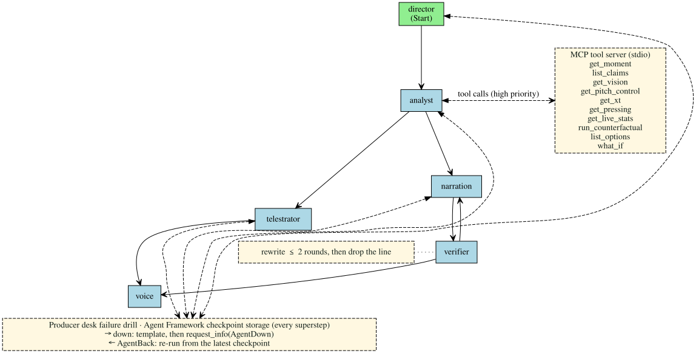

# Rubric map

The five judging criteria of the hackathon's official rules (§6.2 of
[OFFICIAL RULES.md](https://github.com/microsoft/insidethegamehackathon/blob/main/OFFICIAL%20RULES.md),
last changed 2026-09-28; 20% each), each question the judges are asked to look at
(paraphrased), and the points of the Best Multi-Agent System category (§4.2). For each one, the
evidence: a link into the live app, a report, the trailer beat, then the files, tests and pull
requests behind it. **Missing** marks what is not there; **Partial** marks evidence that covers
less than the claim.

- **Live app:** https://ttesite1ff906.z14.web.core.windows.net (no login). Each deep link opens it
  at a spot; the parameters are in [web/README.md](../web/README.md#url-parameters).
- **Trailer:** beats and times from [VIDEO_SCRIPT](VIDEO_SCRIPT.md) (the v13 cut, 1:57).
  TODO(freeze): the published cut's times and URL ([NUMBERS](NUMBERS.md) D6).
- **Numbers:** each number below is listed in [NUMBERS](NUMBERS.md) with the report or command
  that produces it.
- **State:** 2026-10-22, `main` at `39aaf27`. The last CI counts recorded: run 39583678095 on
  `44c0bb5` (2026-10-21), pytest 1216 passed, `npm test` in `web/` 595 passed, the end-to-end
  smoke test 15 of 15 pages. TODO(freeze): the counts on the submitted commit (NUMBERS D3).
  Pull requests are in `timothyzhbw-jpg/through-their-eyes`; work committed straight to `main`
  is cited by commit.

## 1. Technological implementation

The judges ask about synthetic data that is creative and well made, sound software practice
(cloud best practices included), how well the hero technologies are used, and code that is
structured, documented and maintainable.

| Question | Claim | Evidence | Status |
|---|---|---|---|
| Synthetic data | Physics-based synthetic tracking at 25 Hz, with head and body yaw | Live: [the stitched match on the broadcast camera](https://ttesite1ff906.z14.web.core.windows.net/?match=match-1&camera=broadcast&at=751), **View options** → **Skeleton**. Trailer: `pov-look` 0:26. [sim/engine.py](../sim/engine.py), [sim/movement.py](../sim/movement.py), [sim/ball.py](../sim/ball.py); [tests/test_sim_m1.py](../tests/test_sim_m1.py) `test_players_respect_role_speed_and_acceleration_limits`, `test_ball_energy_never_increases_between_contacts`; commit `96abf36` | ✅ |
| Synthetic data | The player's perception, calibrated to published values | [sim/perception.py](../sim/perception.py); [scan_calibration](../eval/reports/scan_calibration.md) fits head speed, scan dwell, pressure and role scan rates to Kokubu et al. 2026, Aksum et al. 2021 and Jordet et al. 2020; PRs #20, #23, #29; the parameter dossier [SIM_PARAMETERS](SIM_PARAMETERS.md) (PR #146) | ✅ |
| Synthetic data | Sim statistics checked against the papers | [realism](../eval/reports/realism.md): scans <!--num:R3.inside-->11<!--/num--> inside the published range, <!--num:R3.outside-->5<!--/num--> outside (4 role effect sizes and the pressure effect, which has the published sign but is too small), 10 with no published reference; team shape 8 inside, 6 outside, 23 with no reference (PR #150) | Partial: 5 + 6 outside |
| Synthetic data | The Laws of the Game hold in every run | [laws](../eval/reports/laws.md): 0 unpunished breaches and 0 wrong or early calls in 3,096 runs, against 237 unpunished on `main` before the referee; offside, the whole ball over a line, restarts, keeper handling. [sim/laws.py](../sim/laws.py), [sim/referee.py](../sim/referee.py); PR #161 | ✅ |
| Synthetic data | A dataset others can use | [DATASET](DATASET.md): 10 stitched matches, events, 25 Hz tracking with head yaw, and at every reception the receiver's scans and beliefs; a datasheet; one possession committed in [data/sample/](../data/sample/), read by [examples/dataset_quickstart.py](../examples/dataset_quickstart.py); PR #108 | Partial: the archive is not released yet (its `gh release create` step in DATASET) |
| Synthetic data | Determinism and counterfactual re-simulation | keyed randomness [sim/rng.py](../sim/rng.py); [tests/test_sim_m1.py](../tests/test_sim_m1.py) `test_same_seed_twice_in_the_same_environment_is_byte_identical`, `test_an_override_on_one_player_leaves_every_draw_of_other_players_unchanged`; [tests/test_whatif.py](../tests/test_whatif.py) `test_forcing_the_action_actually_chosen_reproduces_the_factual_run`; [hero_flip](../eval/reports/hero_flip_blind_side_run.md): <!--num:H1-->33/40<!--/num--> held-out seeds decide differently without the key scan. Byte-identical within one OS; the committed artifacts are generated on Linux, where CI and the API run (SPEC 3.7) | ✅ |
| Synthetic data | Analytics kernels | [analytics/](../analytics/): time to intercept, pitch control, pressing (PRs #1, #4), vision after Bekkers 2026, scan detector (held-out F1 0.991, [scan_detector](../eval/reports/scan_detector.md), PR #3), blind-side alerts (fresh held-out precision 0.914, recall 0.946, [blind_side](../eval/reports/blind_side.md), PRs #10, #13), xT, our own, fitted on synthetic open play with its acceptance checks passed ([xt_fit](../eval/reports/xt_fit.md), [plot](../eval/reports/xt_fit.svg)) | ✅ |
| Software practice | numpy ↔ GLSL parity-tested kernels (SPEC §0) | Pitch control: the tactical board's per-pixel shader ([web/src/pitchControl/](../web/src/pitchControl/)) against [analytics/pitch_control.py](../analytics/pitch_control.py) in headless Chrome on CI, max abs diff about 5e-5 on 10 hero-moment snapshots (SPEC §4 asks < 0.02), [pitchControl.gpu.test.ts](../web/src/pitchControl/pitchControl.gpu.test.ts). The vision cone is a fragment shader of the sim's field-of-view model ([web/src/views/TacticalView.tsx](../web/src/views/TacticalView.tsx)), without occlusion | Partial: the vision cone has no parity test |
| Software practice | CI and deploy | [.github/workflows/ci.yml](../.github/workflows/ci.yml): ruff, pytest, shell syntax; web licences, typecheck, prettier, vitest, build; the end-to-end smoke test with axe-core's WCAG 2.2 rules; prose-only changes skip the heavy jobs (PR #162). [deploy.yml](../.github/workflows/deploy.yml) redeploys on green `main` with OIDC, no stored Azure secret | Partial: the eval reports are generated outside CI and committed |
| Software practice | Cloud practice: identity, limits, health, load | Foundry keyless with a managed identity ([agents/llm.py](../agents/llm.py)); per-client rate limit and daily model cap with the cache and templates behind them (PR #19); a non-root image with `GET /health` ([Dockerfile](../Dockerfile)); a local load test on the deployed size, 0.5 vCPU / 1 GiB: 50 live viewers and a burst of breakdowns and what-ifs, all answered ([OPERATIONS](OPERATIONS.md#load-test-local-never-the-live-service)) | ✅ |
| Hero technologies | The Microsoft stack, each piece used | README [table](../README.md#microsoft-technologies-where-they-are-used): Foundry, Agent Framework, MCP, Azure AI Speech, Container Apps, Storage static website, Cosmos DB, Foundry evaluation, Application Insights, GitHub Actions | ✅ |
| Structure and docs | Code that is structured and documented | one package per stage of the brief's pipeline (README [Layout](../README.md#layout)), each with a README on its modules, data flow, invariants and tests; [SPEC](SPEC.md) with acceptance checks written before the code; [CONTRIBUTING](CONTRIBUTING.md); the architecture diagram is generated from the code and [tests/test_architecture.py](../tests/test_architecture.py) fails when it drifts | ✅ |

## 2. Agentic design and innovation

The judges ask how creatively agentic patterns are applied, whether orchestration, MCP
integration and multi-agent collaboration are sophisticated, and whether the AI is novel or
meaningfully better than existing approaches.

| Question | Claim | Evidence | Status |
|---|---|---|---|
| Orchestration | A production crew as an Agent Framework workflow | [agents/workflow.py](../agents/workflow.py): Director → Analyst → (Telestrator ∥ narration) → Verifier ⇄ narration → Voice, built with `WorkflowBuilder` (fan-out, fan-in, rewrite loop, checkpoints); commit `2fa870a`, parallel lanes PR #11. Live: [Analyst · English](https://ttesite1ff906.z14.web.core.windows.net/?persona=analyst&lang=en&intro=0), **Behind the replay** → **Crew trace**. Trailer: `crew` 1:06 | ✅ |
| Orchestration | The Director's call has consequences | the Director's priority is the breakdown's budget: at high priority the Analyst gets the MCP tools and a 20 s replay slot, lower priorities run without tools in a shorter slot, and the Telestrator is told the slot ([agents/budget.py](../agents/budget.py), PR #123) | ✅ |
| Patterns | Models choose, code states the facts | [agents/schemas.py](../agents/schemas.py): the Analyst and the narrators answer with structured outputs whose claim ids are an enum of verified claims, so a model cannot add a number; [tests/test_agents.py](../tests/test_agents.py) `test_a_model_cannot_add_its_own_words_or_unknown_claims`, `test_model_free_text_with_a_number_is_rejected` | ✅ |
| Patterns | Deterministic verification of every line, per step | [explain/verifier.py](../explain/verifier.py), [explain/claims.py](../explain/claims.py) (PR #6); per-audience rules, required and forbidden claims, enforced in the schema and the Verifier (PR #127); [corruption](../eval/reports/corruption.md): <!--num:A5-->90/90<!--/num--> perturbed claims refuted, 0 unsupported claims rendered. Live: [try a wrong number](https://ttesite1ff906.z14.web.core.windows.net/?persona=analyst&tamper=cf_value). Trailer: `verified` 1:12, `wrong` 1:17 | ✅ |
| Better than existing approaches | Anchoring beats free text | [narration_ablation](../eval/reports/narration_ablation.md) (PR #25): about half of the free-text first-draft lines (34 of 66) name a player or a number that no claim holds, and none passes the Verifier (counting format violations too, 58 of 66 fail it); anchored 0 of 111; groundedness of the scripts that aired 4.90 vs 5.00 (Foundry `GroundednessEvaluator`) | ✅ |
| Novel | Moments chosen by counterfactual impact, the player's perception first | [explain/moments.py](../explain/moments.py), [explain/lenses.py](../explain/lenses.py) (PR #1); the hero lens is the player's perception. Live: [without the look](https://ttesite1ff906.z14.web.core.windows.net/?run=counterfactual&at=decision&view=tactical), [Take his eyes](https://ttesite1ff906.z14.web.core.windows.net/?play=eyes), [Your call](https://ttesite1ff906.z14.web.core.windows.net/?play=yourcall). Trailer: `toggle` 0:32, `eyes-drag` 0:41, `yc-decide` 0:47 | ✅ |
| Novel | A viewer's own question, answered by re-simulation | `POST /api/whatif`: Foundry maps a free question to one of his options, the sim forces it and re-simulates, and the answer is verified lines ([agents/whatif.py](../agents/whatif.py)). Live: [a question, prefilled](https://ttesite1ff906.z14.web.core.windows.net/?ask=What+if+he+had+kept+the+ball+and+dribbled+forward%3F) | ✅ |
| MCP integration | Tools over MCP | [agents/mcp_server.py](../agents/mcp_server.py), started by the deployed API for each uncached model breakdown (PR #41, `TTE_ANALYST_MCP`); [tests/test_api.py](../tests/test_api.py) `test_a_model_breakdown_gives_the_analyst_the_mcp_tools_when_on`; [tests/test_agents.py](../tests/test_agents.py) `test_the_analyst_calls_tools_over_mcp_and_its_trace_names_them` (a real stdio round trip); the live trace below: `execute_tool` and `tools/call` spans under `analyst`. The match recap's Analyst reads the match stats through its own MCP tools ([agents/recap.py](../agents/recap.py)) | ✅ |

## 3. Real-world impact and applicability

The judges ask how significant the problem is, whether the solution could run in production, and
what it means for developers, businesses and end users.

| Question | Claim | Evidence | Status |
|---|---|---|---|
| The problem | Replays show where the ball went, not what the player knew; AI commentary makes up numbers; one game is broadcast to very different audiences | [IMPACT](IMPACT.md); [SUBMISSION](SUBMISSION.md) "The problem" and "Why it matters", with the sources (EY for the Premier League 2026; Microsoft and the Premier League 2025; Amazon Prime Vision) | ✅ |
| Production | Analytics of the player's perception from tracking alone | the scan detector and blind-side alerts read only head yaw and positions, the inputs pose tracking provides ([analytics/scan_detector.py](../analytics/scan_detector.py), [analytics/blind_side.py](../analytics/blind_side.py)); limb-tracking keypoints in: held-out F1 0.991 at the sim's noise, <!--num:A2-->0.962<!--/num--> at 20 mm per axis ([keypoint_ingest](../eval/reports/keypoint_ingest.md)); ReSpo.Vision's broadcast tracking carries head, shoulder and hip angles (Bekkers 2026, [REFERENCES](REFERENCES.md#perception-and-scanning)) | **Missing:** never run on real tracking (synthetic data only, by the rules) |
| Production | Machine-readable, timecoded overlay cues | `TelestrationPlan`: [agents/schemas.py](../agents/schemas.py), [web/src/plan/schema.ts](../web/src/plan/schema.ts); validated on both sides, [tests/test_agents.py](../tests/test_agents.py) `test_plan_validation_matches_the_web_rules`; invalid plans fall back to the template (`?offline=1&plan=invalid`). The recap's cue sheet at 25 fps: `GET /api/recaps/<key>/cues`; live: [the match recap](https://ttesite1ff906.z14.web.core.windows.net/?match=match-1&play=recap) → **Overlay cues (JSON)**. Trailer: `impact` 1:36 | ✅ |
| Production | An audit log of every verified claim | [explain/audit.py](../explain/audit.py), Cosmos DB `claims_audit` (PR #21); live: [`/api/matches/blind_side_run-3/audit`](https://tte-api.whiteground-bd319324.northcentralus.azurecontainerapps.io/api/matches/blind_side_run-3/audit?limit=5); corruption eval: 568/568 verdicts logged | ✅ |
| Production | Runs within a student budget and survives quota loss | cache by content hash, per-client rate limit, daily model cap (PR #19), Cosmos cache (PR #21); [tests/test_api.py](../tests/test_api.py) `test_past_the_daily_cap_breakdowns_serve_the_cache_or_the_template`; the judging window's cost and what happens when a quota runs out: [OPERATIONS](OPERATIONS.md#when-a-quota-runs-out); ≈ $15 expected to 2026-11-10 (SPEC §8) | ✅ |
| End users | One moment for five audiences, two languages | casual, analyst, player fan, coach, and audio description for blind and low-vision fans, in English and Chinese; Azure AI Speech with two voices. Live: [Analyst · 中文](https://ttesite1ff906.z14.web.core.windows.net/?persona=analyst&lang=zh&intro=0), [audio description](https://ttesite1ff906.z14.web.core.windows.net/?persona=audio_description&intro=0). Trailer: `casual` 1:28, `zh` 1:31. Accessibility audit: [ACCESSIBILITY](ACCESSIBILITY.md). Each its own broadcast (PR #205): the mean claim overlap between two audiences <!--num:P1.before-->0.34<!--/num--> → <!--num:P1.after-->0.16<!--/num-->, scripts within their audience's spec <!--num:P2.before-->8<!--/num--> → <!--num:P2.after-->40<!--/num--> of 40 ([persona_distinctness](../eval/reports/persona_distinctness.md)) | ✅ |
| Businesses and developers | Live stats for coaches, an open dataset for developers | `GET /api/matches/<id>/stats`: per player distance, speeds, sprints, passes with accuracy and difficulty, from tracking and events only ([analytics/live_stats.py](../analytics/live_stats.py)); [DATASET](DATASET.md) | Partial: the dataset is not released yet |
| Businesses | Who pays, for what, and the cost to serve | [SUBMISSION, Business model](SUBMISSION.md#business-model): the offers as hypotheses (broadcasters, clubs, the league's fan apps; no betting); measured cost per breakdown (about $0.01, [crew_vs_single](../eval/reports/crew_vs_single.md)), speech per line and hosting per month at Azure list prices of 2026-10-22 | Partial: no customer has seen it, no price is set, and the cache's share of views is not measured yet |
| End users | Three named users: broadcasters, coaches and academies, blind and low-vision fans | [SUBMISSION, Who uses it](SUBMISSION.md#who-uses-it); the academy drill, the cue sheet and the audio-description audience are all in the live app | Partial: the Jordet et al. (2020) link is an association, and whether the drill changes anyone's scanning is untested |
| End users | Viewers understand the play better | — | **Missing:** the optional viewer pilot (SPEC §9) has not run |

## 4. User experience and presentation

The judges ask whether the experience is well designed and intuitive, whether the demo video
communicates the project's value, and whether frontend and backend are balanced.

| Question | Claim | Evidence | Status |
|---|---|---|---|
| Intuitive | A first-time visitor has one path | the intro card is one line and **Start** (PR #177); one panel per tour step (PR #179); the ten-step judge tour, [from its first step](https://ttesite1ff906.z14.web.core.windows.net/?tour=1). README ["Judge it in 3 minutes"](../README.md#judge-it-in-3-minutes) and ["The full tour"](../README.md#the-full-tour); the team's live-demo script, `docs/DEMO_SCRIPT.md` | Partial: the quick tour (`?tour=quick`) is PR #178, not merged |
| Well designed | First-person replay and a tactical board | [web/](../web/) (PR #5), head and body yaw on every player (PR #7), animated players (PRs #26, #27), comfort mode. Live: [first person at the key scan](https://ttesite1ff906.z14.web.core.windows.net/?view=pov&at=key-scan&intro=0). Trailer: `pov-look` 0:26 | ✅ |
| Well designed | Overlays | pass options with "he thought / it was" (PR #8), blind-side alerts (PR #12), What if… ghost paths (PR #9), pitch control on the tactical board (toggle, off by default), the scan step-through (PR #136), the run without the look told in verified lines (PR #139) | ✅ |
| Well designed | Live, with persona and language switching | live WebSocket replay, breakdowns per persona × language (en, zh), Azure AI Speech (PR #24); the first request per persona and language runs the crew (12.9 s on a warm replica, [SPEC §8](SPEC.md#8-platform-and-deploy), 2026-10-20), later ones come from the cache | ✅ |
| Well designed | Every caption opens its evidence | [web/src/ui/Narration.tsx](../web/src/ui/Narration.tsx): claims with kind, verdict, values and evidence events; seeks the replay; every number on screen says where it comes from (PR #173) | ✅ |
| Well designed | Broadcast camera and a camera director | [web/src/views/broadcast.ts](../web/src/views/broadcast.ts), `?camera=broadcast` (PR #32); the director that suggests and cuts cameras (PR #56). Live: [the stitched match](https://ttesite1ff906.z14.web.core.windows.net/?match=match-1&camera=broadcast&at=751) | ✅ |
| Well designed | A control to try a wrong number against the verifier | Evidence card **Try a wrong number** ([web/src/ui/Narration.tsx](../web/src/ui/Narration.tsx), [web/src/tamper/](../web/src/tamper/)) → `POST /api/verify` ([api/tamper.py](../api/tamper.py)): the real Verifier on the claim with the viewer's number, not audited; tests in [tests/test_api.py](../tests/test_api.py) and [web/src/tamper/tamper.test.tsx](../web/src/tamper/tamper.test.tsx). Live: [`?persona=analyst&tamper=cf_value`](https://ttesite1ff906.z14.web.core.windows.net/?persona=analyst&tamper=cf_value) | ✅ |
| Well designed | Accessible and fast on a phone | axe-core WCAG 2.2 A/AA on 13 screens at 1440×900 and 375×812, and in every CI smoke page ([ACCESSIBILITY](ACCESSIBILITY.md)); cold-load timings of the live site on laptop and phone, plain and on Fast 3G ([web_load](../eval/reports/web_load.md)) | ✅; nothing tested with a real screen reader |
| Well designed | 60 fps on an integrated GPU with the pitch-control shader on | `cd web && npm run build && npm run fps -- --headed`; 60 fps capped on an Apple M4 Pro, headless (SPEC §7, 2026-10-21) | Partial: no run on a PC laptop's integrated GPU with the shader on |
| The video | The demo video communicates the value | [VIDEO_SCRIPT](VIDEO_SCRIPT.md): a staged story (labelled a dramatisation), then the app in three chapters, the crew, the verifier, the drill, the audiences; numbers only from verified claims; burned-in captions; PRs #170, #171, v14 in #182 | Partial: TODO(Bowen): the public video URL |
| Balance | Frontend and backend | front: React, three.js and GLSL shaders in [web/](../web/) with its own test suite; back: the simulator, analytics, explain layer, the agent crew and the API in Python ([architecture](../README.md#architecture)); the two meet in typed schemas validated on both sides (`TelestrationPlan`, the claims) | ✅ |

## 5. Category adherence: Best Multi-Agent System

The category asks for specialised agents with distinct roles, coordination through shared state
and handoffs, recovery from failures, and "an end-to-end outcome a single agent could not achieve
as effectively". The last point is the one we measured against a single agent
([crew_vs_single](../eval/reports/crew_vs_single.md)); what it showed is in
[Why a crew](#why-a-crew) below.

| Point | Evidence | Status |
|---|---|---|
| Distinct roles | Director (whether and why to explain the moment, and so its budget), Analyst (lens and headline claims, with MCP tools), Telestrator (the `TelestrationPlan`), narration (two voices, play-by-play and colour, per persona and language), Verifier and Voice. Prompts: [agents/prompts.py](../agents/prompts.py). Live: **Crew trace** shows each agent's lane | ✅; Verifier and Voice are deterministic code by design, not models |
| Shared state | `MomentContext` ([agents/context.py](../agents/context.py)): the run, the counterfactual, moment cards, claims, verdicts and the audit sink, read by every step; `Crew` ([agents/workflow.py](../agents/workflow.py)) holds the step trace and spans; the Crew trace shows which state each step read and wrote (PR #112, [tests/test_crew_trace.py](../tests/test_crew_trace.py)) | ✅ |
| Handoffs | typed messages on the workflow's edges (`Briefing`, `Planned`, `Drafts`, `Rewrite`, `Approved` in [agents/workflow.py](../agents/workflow.py)); [tests/test_agents.py](../tests/test_agents.py) `test_telestrator_and_narration_run_concurrently`; [tests/test_telemetry.py](../tests/test_telemetry.py) `test_the_parallel_lanes_overlap_and_stay_children_of_the_breakdown` | ✅ |
| Failure recovery | Each model step: a timeout, one retry, then its template. The failure drill (SPEC §6): the Producer desk takes an agent down and brings it back from the Agent Framework workflow checkpoint, which re-runs only that step and the one after it; an interrupted breakdown resumes from its last superstep, after a restart too ([tests/test_crew_recovery.py](../tests/test_crew_recovery.py), [tests/test_api_drill.py](../tests/test_api_drill.py), [web/src/producer/producer.test.tsx](../web/src/producer/producer.test.tsx)). Measured: with the Analyst or the Telestrator down, the crew aired a valid, verified breakdown 3 of 3 times with 3 of 4 model roles intact; one agent doing all four roles kept 0 of 4 ([crew_vs_single](../eval/reports/crew_vs_single.md), "Failure drill"). Offline, through the real workflow with a scripted model ([crew_evidence](../eval/reports/crew_evidence.md), PR #195): with any one of the four agents down, 280/280 scripts aired in 28 drills and the crew kept 3 of 4 roles on the model, the single agent 0 of 4; bringing the agent back restored the fault-free breakdown in 70/70 drills; with the model service down, every API request was still answered with a verified breakdown, on templates. Live: [the failure drill](https://ttesite1ff906.z14.web.core.windows.net/?tour=producer). Trailer: `redcard` 1:21, `bringback` 1:24 | Partial: a drill lives on the replica's disk, so every restart or redeploy drops it, and bring-back then answers 404; in a model outage the all-template run is cached under the model's key and its chip reads Live, then Cached (crew_evidence's finding; the Producer desk shows the template steps) |
| End-to-end outcome | one `BreakdownResult` = a validated plan + verified scripts per persona and language + timed SSML cues, played by the web app; measured against a single agent on the same inputs ([crew_vs_single](../eval/reports/crew_vs_single.md)): see [Why a crew](#why-a-crew) | Partial: the crew's lines are no better than one agent's; its advantage is recovery, timing and auditability |

### The crew's graph and the four asks

<picture>
  <source media="(prefers-color-scheme: dark)" srcset="crew_workflow-dark.svg">
  
</picture>

Agent Framework's own `WorkflowViz` draws this graph from the workflow the API runs
(`build_workflow`); the MCP tool server, the Verifier's rewrite loop and the failure drill's
bring-back are added from the code ([docs/crew_workflow.py](../docs/crew_workflow.py), checked by
[tests/test_crew_workflow_diagram.py](../tests/test_crew_workflow_diagram.py)). The category asks
for four things; each has a measured number ([docs/NUMBERS.md](../docs/NUMBERS.md), rows MA).

#### "Distinct roles"

The crew has model agents (Director, Analyst, Telestrator, and narration with its two voices) and code steps
(Verifier, Voice), each with its own schema, timeout and template. The Verifier is a separate gate
that can veto. Of <!--num:MA8.total-->2,837<!--/num--> deliberately broken lines, the Verifier kept every one off the air; without it, <!--num:MA8.aired-->2,823<!--/num--> would have aired, <!--num:MA8.false-->888<!--/num--> of them stating something false ([crew_evidence](../eval/reports/crew_evidence.md), MA8).

#### "Coordinate through shared state and effective handoffs"

Typed messages on the workflow's edges, and one verified body of evidence every step reads. The
crew trace records each handoff: 394 of 394 aired lines trace to their verified claims, the voice
call that chose them, the Verifier round that passed them and their voice cue
([crew_evidence](../eval/reports/crew_evidence.md), MA10).

#### "Recover from failures"

With any one agent taken down, every script still aired and most roles still came from the
model; one agent doing all the roles kept none. Bringing the agent back from the Agent
Framework checkpoint restored the fault-free breakdown in every drill ([crew_evidence](../eval/reports/crew_evidence.md),
MA1, MA7). Try it on the live site: [the failure drill](https://ttesite1ff906.z14.web.core.windows.net/?tour=producer).

#### "An end-to-end outcome a single agent could not achieve as effectively"

What the crew buys is a breakdown that finishes inside the step budget, survives a fault and
recovers cheaply. Under the deployed step timeout, no crew agent run would have timed
out, while every run of one agent doing all the roles in one call would have (MA3). Bringing the
Telestrator back costs the crew less than the single agent's re-run (MA2); the Analyst costs more,
because every step after it runs again (MA2b). What it does not buy is better lines: both
structures aired no wrong facts and scored the same on groundedness
([crew_vs_single](../eval/reports/crew_vs_single.md), MA5).

<!-- TODO(freeze): a screenshot of one live breakdown's trace in Application Insights (the agent
spans and their handoffs), taken after the 10/24 prewarm; save it as
docs/screenshots/appinsights-trace.png and show it here (docs/NUMBERS.md D2). -->

### Why a crew

We ran one Foundry agent doing the four model roles in one call (the crew's schemas side by
side, the same MCP tools, the same code after the model) against the crew, on six moments × four
audiences, each with and without the Verifier
([crew_vs_single](../eval/reports/crew_vs_single.md), 2026-10-21).

**What the crew does not buy.** Better lines. Both aired 0 wrong facts, both scored 5.00 for
groundedness, and the Verifier rejected no anchored line in either structure. On free-text lines
the separate voices wrote more wrong facts than the single agent (12 vs 3 on one moment); the
Verifier, not the crew, stopped all of them. The crew costs about twice as much per breakdown
($0.0090 vs $0.0046).

**What it does buy:**
- **Recovery that keeps the rest of the work.** One agent down: the crew still aired 3 of 4 roles
  from the model, the single agent 0 of 4, since its one call is every role. Bringing an agent
  back depends on where it sits. The Telestrator, which nothing downstream reads, cost the crew 1
  model request (about 2.1k tokens) against the single agent's full re-run (1.7 requests, about
  11.7k tokens). The Analyst, whose findings every later step reads, cost the crew more: 11.0
  requests (about 21.6k tokens), because the steps after it run again, against the same 1.7
  requests and about 11.7k tokens for the single agent. Offline at Foundry's median latencies,
  the Telestrator is back in about 4 s and the Analyst in about 8 s; the single agent's only way
  back is its whole call, about 9.5 s, and under the deployed 8 s step timeout it never comes
  back ([crew_evidence](../eval/reports/crew_evidence.md), PR #195, a scripted model through the
  real workflow; its wall times move by up to half a second from run to run, its counts do
  not).
- **Steps that fit the deployed timeout.** The API gives each model step 8 s. The eval allowed
  30 s, and 0 of 66 crew agent runs took longer than 8 s, against 6 of 6 single-agent runs: under
  the deployed timeout the single agent would have fallen back to its templates on every
  moment. Offline, under that timeout its call times out twice and the breakdown airs on
  templates after about 16 s (crew_evidence).
- **A Verifier per step, and a rewrite sent to the line's author.** A rejected line goes back to
  the voice that wrote it, told why; the other lines and the plan stand
  ([agents/workflow.py](../agents/workflow.py)). The broken lines are a number or
  player the model wrote, an unbacked term, a broken placeholder, an unknown, forbidden or
  tampered claim. Of <!--num:V1.total-->2,837<!--/num--> deliberately broken lines, the Verifier kept every one off the air; without it, <!--num:V1.aired-->2,823<!--/num--> would have aired, <!--num:V1.false-->888<!--/num--> of them stating something false. On
  the Foundry drafts it rejected 0 of 234 anchored lines: the schema already prevents those
  errors (crew_evidence).
- **Audiences in parallel.** Narration drafts every persona × language script at once, and
  rewrites only the scripts that broke a rule. Offline at Foundry's median latencies, narration
  takes about 3.5 s for ten scripts as for one; one call at a time the breakdown would take
  about 22 s instead of about 9 s. It is still not faster than one agent: about 9 s either way
  offline, 13.8 s against 14.4 s on Foundry (crew_evidence, crew_vs_single).
- **An audit trail per agent.** Every breakdown carries its trace: each step's typed input and
  output, the state it read and wrote, the Analyst's MCP calls, the Verifier's verdicts, and
  whether a line came from the model or a template. The **Crew trace** shows it in the app, and
  Application Insights has the same run as spans (below). Offline, 394 of 394 aired lines traced
  to verified claims with an audit record, the voice call that chose them, the Verifier round
  that passed them and their voice cue. One gap: the trace keeps 4,000 characters of a tool
  result, so for 52 of 352 claim lines the stored tool result no longer names the claim
  (crew_evidence).
- **Plans that validate.** 6 of 6 crew plans passed the web app's rules, against 5 of 6 from the
  single agent (one named a scan that does not exist).
- **More of the headline spoken.** The crew's scripts carried 92% of the Analyst's headline
  claims, the single agent's 81%; the crew's scripts are also longer (about 24 lines against
  18), and the paired interval reaches zero (+0.11, 95% interval −0.00 to +0.24).

### The live trace

TODO(freeze): re-capture after the last deploy (NUMBERS D2). This one predates the Director's
budget (PR #123), the names (PR #126) and the persona rules (PR #127).

One model-backed breakdown (coach, en) on the deployed API, from Application Insights,
2026-10-20 21:34:51 UTC (revision `tte-api--0000017`, image `6e58a48`), 15.5 s inside the
`breakdown` span: 5.1 s to start our MCP server, then 9.9 s for the crew. Spans with their
attributes (`tte.source`: `llm` = the model answered, `code` = deterministic step); HTTP and
framework plumbing spans trimmed.

```
POST /api/breakdowns                                   23826 ms
├─ ContainerProxy.upsert_item ×24  (the match's claims audit: first request after the deploy)
├─ breakdown  personas=coach languages=en model=gpt-4.1-mini rewrites=0 dropped=0   15467 ms
│  ├─ mcp  source=code tools=get_moment,list_claims,get_vision,get_pitch_control,get_xt,
│  │       get_pressing,run_counterfactual,list_options,what_if                    5093 ms
│  │  ├─ initialize  (python -m agents.mcp_server, a subprocess)                   4621 ms
│  │  ├─ tools/list                                                                   4 ms
│  │  └─ prompts/list                                                                 3 ms
│  ├─ workflow.run                                      9898 ms
│  │  ├─ executor.process director                      2373 ms
│  │  ├─ executor.process analyst                       3590 ms
│  │  ├─ executor.process telestrator                   3095 ms   ┐ fan-out, concurrent
│  │  ├─ executor.process narration                     3884 ms   ┘
│  │  ├─ executor.process voice                            0 ms   (the plan: waits for the scripts)
│  │  ├─ executor.process verifier                         4 ms
│  │  └─ executor.process voice                            1 ms   (the approved scripts: speaks)
│  ├─ director     source=llm attempts=1                2373 ms → invoke_agent → chat gpt-4.1-mini
│  ├─ analyst      source=llm attempts=1 tools_called=get_moment,list_claims      3590 ms
│  │  └─ invoke_agent analyst                           3588 ms
│  │     ├─ chat gpt-4.1-mini                           1528 ms   (asks for two tools)
│  │     ├─ execute_tool get_moment → tools/call get_moment     10 ms   (over MCP stdio)
│  │     ├─ execute_tool list_claims → tools/call list_claims   13 ms
│  │     └─ chat gpt-4.1-mini                           2041 ms   (the structured answer)
│  ├─ telestrator  source=llm attempts=1                3094 ms → invoke_agent → chat gpt-4.1-mini
│  ├─ narration    speaker=pbp   source=llm lines=3     1976 ms → invoke_agent → chat gpt-4.1-mini
│  ├─ narration    speaker=color source=llm lines=3     1898 ms → invoke_agent → chat gpt-4.1-mini
│  ├─ verifier     round=0 source=code failed=0            3 ms
│  └─ voice        source=code lines=6                     0 ms
├─ ContainerProxy.upsert_item (Cosmos cache write)       242 ms
└─ ContainerProxy.read_item ×6, upsert_item ×2  (the voice cues POST /api/tts may speak)
```

Every span of the trace arrives, each with `itemCount` 1 (unsampled), and so does every span of
the next breakdown (player_fan, zh, 21:35:08 UTC: the same steps, 82 spans). Since PR #50
`configure_tracing` keeps all spans. Before it, the distro's default sampler (5 spans per second,
decided span by span) dropped steps out of the bursts a breakdown makes: earlier traces of the
day lack `voice`, some also `mcp` or `verifier`.

Query (Application Insights `tte-appi-1ff906`, Logs). It keeps to requests that reached the
deployed API, because local runs with the connection string set report under the same role name:

```kusto
let deployed = requests
    | where url has 'azurecontainerapps.io' and name has 'breakdowns' | project operation_Id;
let op = toscalar(dependencies
    | where name == 'breakdown' and operation_Id in (deployed)
    | top 1 by timestamp desc | project operation_Id);
union dependencies, requests
| where operation_Id == op
| project timestamp, name, id, operation_ParentId, duration, customDimensions
| order by timestamp asc
```

## Development tools

Built with Claude Code. GitHub Copilot, the Azure MCP Server and Microsoft Fabric were not used:
no commit, file or pull request mentions them (git history and all 30 pull requests checked on
2026-10-20; TODO(freeze): re-check every pull request, NUMBERS D4), so no Copilot usage file is
included.
