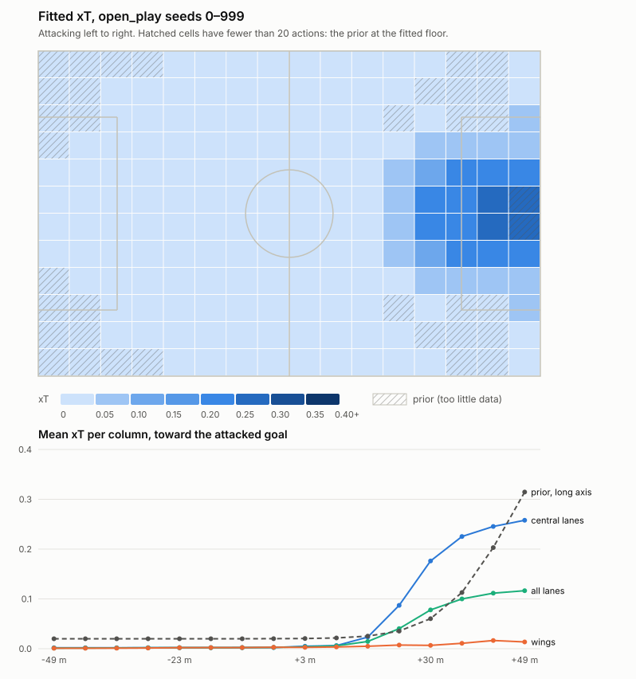

# xT fit — Markov expected threat on synthetic open play

`uv run python -m eval.xt_fit` (23 min). Grid 16 × 12 for a team attacking +x, fitted by value iteration on `xT(z) = s(z)·g(z) + m(z)·Σ T(z→z')·xT(z')` (Singh 2019; our own implementation in `analytics/xt.py`, socceraction is not used). Cached in `analytics/xt_grid.json` for sim version `ac5d84f031d53bb3`.

## Data

`open_play` seeds 0–5999, 45 s each: `possession_play`'s shape, pressing and marking, but every ball carrier decides with the decision model on his belief (SPEC 3.5), so play moves toward goal and some possessions end in shots. A shot scores its expected goals under the sim's shot model (the decision model's xG; the engine has no shot outcome model). A lost ball is worth 0. The decision model values options with the smooth prior, not this grid: the grid is fitted on the play it drives.

The scripted scenarios cannot carry the fit: they have no shots at all.

| Scenario (seeds) | Played (s) | Decisions | Passes complete / lost | Carries | Shots | Expected goals | Actions from the box |
|---|---|---|---|---|---|---|---|
| `open_play` (0–5999) | 239052 | 124007 | 83882 / 7338 | 28356 | 1017 | 117.3 | 2028 |
| `possession_play` (0–99) | 4504 | 0 | 1217 / 412 | 0 | 0 | 0.0 | 1 |
| `blind_side_run` (0–99) | 631 | 100 | 193 / 0 | 7 | 0 | 0.0 | 0 |

Fit: 120074 actions, 1017 shots, each also counted mirrored across the long axis (open play is symmetric in y: mirror-image shapes, jitter and physics). 186/192 cells have at least 20 actions (their own plus their mirror image's) and are fitted. The rest keep the smooth prior, moved down to the lowest fitted value: the prior's floor of 0.02 is a guess, and the fit measures it. At least 30 shots are needed for any fit. Status: **fitted**.

## Acceptance checks (SPEC 4)

| Check | Value | Pass |
|---|---|---|
| Values in [0, 1] | 0.0018 – 0.3400 | yes |
| Column means never drop by more than 0.01 toward goal | worst step +0.0000 | yes |
| Central-lane means never drop by more than 0.02 toward goal | worst step -0.0000 | yes |
| Last 3 columns minus first 3 columns ≥ 0.05 | +0.1053 | yes |
| Every lane: near goal ≥ own half − 0.01 | worst +0.0154 | yes |
| Near goal: central lanes ≥ wings, each of the last 3 columns | smallest margin +0.1705 | yes |

Sanity plot: [xt_fit.svg](xt_fit.svg). Tested by [tests/test_xt.py](../../tests/test_xt.py) on the cached grid.

## Grid

Rows are lanes (y, metres from the long axis), columns run toward the attacked goal (x of the cell centre). *Italic*: too little data, the prior at the fitted floor.

| lane \ x (m) | -49 | -43 | -36 | -30 | -23 | -16 | -10 | -3 | +3 | +10 | +16 | +23 | +30 | +36 | +43 | +49 |
|---|---|---|---|---|---|---|---|---|---|---|---|---|---|---|---|---|
| +31.2 | *0.002* | *0.002* | 0.002 | 0.002 | 0.002 | 0.002 | 0.002 | 0.003 | 0.003 | 0.004 | 0.006 | 0.011 | 0.014 | 0.016 | 0.018 | 0.019 |
| +25.5 | *0.002* | 0.002 | 0.002 | 0.002 | 0.002 | 0.002 | 0.002 | 0.003 | 0.003 | 0.004 | 0.009 | 0.017 | 0.023 | 0.023 | 0.024 | 0.023 |
| +19.8 | 0.002 | 0.002 | 0.002 | 0.002 | 0.002 | 0.002 | 0.002 | 0.003 | 0.003 | 0.007 | 0.012 | 0.025 | 0.039 | 0.044 | 0.047 | 0.049 |
| +14.2 | 0.002 | 0.002 | 0.002 | 0.002 | 0.002 | 0.002 | 0.002 | 0.003 | 0.003 | 0.006 | 0.018 | 0.046 | 0.080 | 0.105 | 0.107 | 0.109 |
| +8.5 | 0.002 | 0.002 | 0.002 | 0.002 | 0.002 | 0.002 | 0.002 | 0.003 | 0.003 | 0.006 | 0.020 | 0.066 | 0.126 | 0.180 | 0.199 | 0.222 |
| +2.8 | 0.002 | 0.002 | 0.002 | 0.002 | 0.002 | 0.002 | 0.002 | 0.002 | 0.003 | 0.007 | 0.025 | 0.104 | 0.172 | 0.200 | 0.207 | 0.340 |
| -2.8 | 0.002 | 0.002 | 0.002 | 0.002 | 0.002 | 0.002 | 0.002 | 0.002 | 0.003 | 0.007 | 0.025 | 0.104 | 0.172 | 0.200 | 0.207 | 0.340 |
| -8.5 | 0.002 | 0.002 | 0.002 | 0.002 | 0.002 | 0.002 | 0.002 | 0.003 | 0.003 | 0.006 | 0.020 | 0.066 | 0.126 | 0.180 | 0.199 | 0.222 |
| -14.2 | 0.002 | 0.002 | 0.002 | 0.002 | 0.002 | 0.002 | 0.002 | 0.003 | 0.003 | 0.006 | 0.018 | 0.046 | 0.080 | 0.105 | 0.107 | 0.109 |
| -19.8 | 0.002 | 0.002 | 0.002 | 0.002 | 0.002 | 0.002 | 0.002 | 0.003 | 0.003 | 0.007 | 0.012 | 0.025 | 0.039 | 0.044 | 0.047 | 0.049 |
| -25.5 | *0.002* | 0.002 | 0.002 | 0.002 | 0.002 | 0.002 | 0.002 | 0.003 | 0.003 | 0.004 | 0.009 | 0.017 | 0.023 | 0.023 | 0.024 | 0.023 |
| -31.2 | *0.002* | *0.002* | 0.002 | 0.002 | 0.002 | 0.002 | 0.002 | 0.003 | 0.003 | 0.004 | 0.006 | 0.011 | 0.014 | 0.016 | 0.018 | 0.019 |

Column means: 0.002, 0.002, 0.002, 0.002, 0.002, 0.002, 0.002, 0.003, 0.003, 0.006, 0.015, 0.045, 0.076, 0.095, 0.100, 0.127.

## Stability

The same fit on each half of the seeds (0–2999 and 3000–5999).

| | First half | Second half |
|---|---|---|
| Shots | 516 | 501 |
| Fitted cells | 180 | 178 |
| All checks pass | yes | yes |
| Column means | 0.002, 0.002, 0.002, 0.002, 0.002, 0.002, 0.002, 0.003, 0.004, 0.006, 0.016, 0.045, 0.075, 0.095, 0.100, 0.117 | 0.002, 0.002, 0.002, 0.002, 0.002, 0.002, 0.002, 0.003, 0.003, 0.005, 0.014, 0.044, 0.075, 0.094, 0.101, 0.117 |
| The look's ΔxT on `blind_side_run` seed 3 (narrated) | 0.1549 (0.15) | 0.1551 (0.16) |
| Actions in the cell where that pass ends, (14, 4) | 148 (fitted) | 122 (fitted) |

Cell by cell, where both halves fit the cell (174 cells): mean |Δ| 0.0017, 95th percentile 0.0077, max 0.0109. Column means differ by at most 0.0022. The hero's pass ends at (40.8, -10.8) m, where play in the sim is thin: the whole fit has 270 (fitted) actions in that cell, each half alone too few, so the halves' look values lean on the prior there.

## What changes downstream

Analytics and explain read the fitted grid (`analytics.xt.xt_for`): possession value after an action (`sim.counterfactual`, the ΔxT of a counterfactual), the lens values (`explain.lenses`), pass xT gain (`explain.moments`) and the Analyst's `get_xt` tool. The sim's decisions do not change, so neither does any run.

Hero moment (`blind_side_run` seed 3: `pass:H9`, without the look `pass:H4`; unchanged):

| Number | Prior | Fitted grid | Narrated |
|---|---|---|---|
| The look's ΔxT (“That look was worth … in expected threat”) | 0.0975 | 0.1551 | 0.10 → 0.16 |
| Lens `scan` Δ | +0.0903 | +0.1534 | not narrated |
| Lens `space` Δ | +0.0868 | +0.1363 | not narrated |
| Lens `pressure` Δ | -0.0008 | -0.0010 | not narrated |
| Selected lens | `scan` | `scan` | — |

Lens selection on `blind_side_run` seeds 0–39 and 100–139 (80, SPEC 5.2):

| | `scan` selected | Median Δscan − Δspace | Δscan ≥ Δspace |
|---|---|---|---|
| Prior | 69/80 | 0.0030 | 80/80 |
| Fitted grid | 69/80 | 0.0143 | 80/80 |
